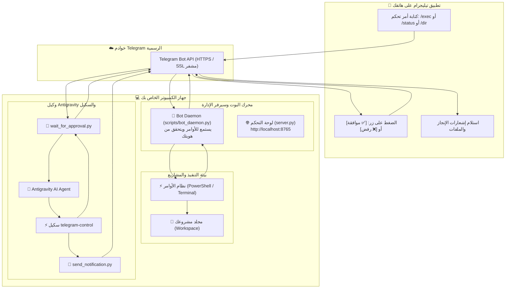

# 🤖 دليل تشغيل والتحكم في Antigravity عبر بوت تيليجرام
### Complete Guide: Antigravity Telegram Control & Bridge

---

## 📌 الفهرس (Table of Contents)
1. [💡 كيف يعمل النظام بالتفصيل؟ (How It Works)](#1-كيف-يعمل-النظام-بالتفصيل)
2. [🔗 كيف تربط السكيل بمشروعك الحالي أو أي مشروع جديد؟ (How to Link to Projects)](#2-كيف-تربط-السكيل-بمشروعك-الحالي-أو-أي-مشروع-جديد)
3. [🚀 دليل التثبيت والإعداد السريع (Quick Setup Guide)](#3-دليل-التثبيت-والإعداد-السريع)
4. [📱 أوامر التحكم عن بُعد من تطبيق تيليجرام (Telegram Remote Commands)](#4-أوامر-التحكم-عن-بُعد-من-تطبيق-تيليجرام)
5. [🤖 كيف تستخدم السكيل مع Antigravity في الشات؟ (Agent Interaction Examples)](#5-كيف-تستخدم-السكيل-مع-antigravity-في-الشات)
6. [🛠 أدوات السكيل البرمجية (Scripts & CLI Tools)](#6-أدوات-السكيل-البرمجية)
7. [🌐 لوحة التحكم وإدارة الويب (Web Dashboard Guide)](#7-لوحة-التحكم-وإدارة-الويب)
8. [🛡 نظام الأمان وإدارة الصلاحيات (Security & Whitelist)](#8-نظام-الأمان-وإدارة-الصلاحيات)
9. [🔌 واجهات البرمجة المحلية (REST APIs Reference)](#9-واجهات-البرمجة-المحلية)
10. [❓ الأسئلة الشائعة واستكشاف الأخطاء (Troubleshooting & FAQ)](#10-الأسئلة-الشائعة-واستكشاف-الأخطاء)

---

## 1. كيف يعمل النظام بالتفصيل؟

النظام عبارة عن **جسر ذكي ثنائي الاتجاه (Bi-Directional Bridge)** يربط بين هاتفك المحمول عبر **تطبيق تيليجرام** وبين جهاز الكمبيوتر ووكيل **Google Antigravity**.



---

### 🔄 مسار العمل في الاتجاهين:

#### 1️⃣ الاتجاه الأول: التحكم عن بُعد (من هاتفك إلى جهازك)
- أنت خارج المنزل أو بعيد عن جهازك وتريد تشغيل أمر أو فحص كود أو تشغيل اختبارات.
- تفتح محادثة البوت على تيليجرام وتكتب مثلاً:
  ```text
  /exec git status
  ```
  أو
  ```text
  /status
  ```
- **ماذا يحدث في جهازك؟**
  1. خدمة البوت (`bot_daemon.py`) التي تعمل في خلفية جهازك تستقبل الرسالة عبر بروتوكول مشفر.
  2. يتحقق البوت فوراً من رقم حسابك (User ID) للتأكد أنك أنت صاحب الجهاز ولست غريباً.
  3. يقوم البوت بتنفيذ الأمر عبر **PowerShell** مباشرة داخل مجلد مشروعك.
  4. يلتقط البوت الناتج، ويقوم بتنسيقه ويرسله إلى محادثة تيليجرام على هاتفك في أقل من ثانية!

#### 2️⃣ الاتجاه الثاني: الإشعارات والموافقات (من Antigravity إلى هاتفك)
- أنت تعمل مع Antigravity على مشروع كبير، أو طلبت منه بناء تطبيق أو تعديل قاعدة بيانات.
- يمتلك Antigravity الآن مهارة (Skill) اسمها `telegram-control`.
- عند اكتمال المهمة أو عند بناء ملفات، يقوم Antigravity تلقائياً باستدعاء سكريبت `send_notification.py` ليرسل لك تقرير الإنجاز مرفقاً بالملفات لهاتفك.
- وعند رغبة Antigravity في تنفيذ أمر خطير (مثل حذف مجلد أو تعديل جدول داتابيز)، يستدعي `wait_for_approval.py`، فتصلك رسالة بأزرار تفاعلية:
  - `[✅ موافقة / Approve]`
  - `[❌ رفض / Reject]`
- يعلق Antigravity التنفيذ في جهازك حتى تضغط بيدك على الزر في تيليجرام، فإذا وافقت يُكمل، وإذا رفضت يتوقف تماماً!

---

## 2. كيف تربط السكيل بمشروعك الحالي أو أي مشروع جديد؟

النظام مصمم ليكون مرناً للغاية؛ حيث يمكنك استخدامه **في المشروع الحالي** أو ربطه بـ **أي مشروع على جهازك** بعدة طرق سهلة:

---

### 🔹 الطريقة الأولى: الربط التلقائي عبر السكيل العام (Global Skill)
> **هذه الطريقة تعمل فوراً في كل مشاريعك بدون الحاجة لنسخ أي ملفات!**

تم تثبيت السكيل في المسار العام لنظام Antigravity:
```text
C:\Users\<اسم_المستخدم>\.gemini\config\skills\telegram-control\
```
- **كيف تستخدمه في أي مشروع؟**
  1. افتح أي مشروع أو مجلد تريده في Antigravity (مثلاً: `C:\xampp\htdocs\my_shop` أو `D:\work\python_project`).
  2. اطلب من Antigravity في الشات مباشرة:
     - *"ابعتلي رسالة على تليجرام لما تخلص الكود"*
     - *"لو احتجت تحذف ملف اطلب موافقتي من تيليجرام أولاً"*
  3. سيتعرف Antigravity تلقائياً على السكيل ويستخدمه فوراً دون أن تفعل أي شيء إضافي!

---

### 🔹 الطريقة الثانية: ربط مشروع محدد للتحكم عن بُعد من الهاتف (Remote Workspace Linking)
إذا كنت تستخدم تيليجرام للتحكم عن بعد، وتريد للبوت أن ينفذ أوامره (`/exec`, `/dir`, `/read`) داخل مشروع معين على جهازك:

#### أ) من داخل تيليجرام مباشرة (أسهل طريقة وأنت بالخارج):
افتح محادثة البوت وأرسل مسار المشروع الجديد:
```text
/workspace C:\xampp\htdocs\my_shop
```
أو
```text
/cd D:\projects\ecommerce
```
- سيقوم البوت فوراً بالرد:
  > ✅ **تم تغيير مجلد العمل بنجاح!** المسار الجديد: `C:\xampp\htdocs\my_shop`. جميع الأوامر الآن ستنفذ داخل هذا المشروع.
- للتحقق من المشروع الحالي في أي وقت، أرسل:
  ```text
  /workspace
  ```

#### ب) من خلال ملف الإعدادات (`config.json`):
في مجلد `c:\xampp\skill\config.json`، يمكنك إضافة أو تعديل المسار:
```json
{
  "bot_token": "YOUR_BOT_TOKEN",
  "allowed_chat_ids": [123456789],
  "workspace_dir": "C:\\xampp\\htdocs\\my_shop"
}
```

---

### 🔹 الطريقة الثالثة: تضمين السكيل محلياً داخل مشروع خاص (Project-Specific Skill)
إذا كان لديك مشروع خاص وتريد حفظ السكيل داخله ومشاركته مع فريق العمل عبر Git:
1. انسخ مجلد `.agents/skills/telegram-control` من هذا المشروع.
2. ضعه داخل مجلد مشروعك الجديد في المسار:
   ```text
   your_project/
   └── .agents/
       └── skills/
           └── telegram-control/
               ├── SKILL.md
               └── scripts/
   ```
3. عند فتح هذا المشروع، سيعطي Antigravity الأولوية لسكيل المشروع المحلي تلقائياً.

---

## 3. دليل التثبيت والإعداد السريع

### 1. استخراج التوكن من تيليجرام:
1. افتح تيليجرام وابحث عن `@BotFather`.
2. أرسل الأمر `/newbot` واختر اسماً ومعرفاً ينتهي بـ `bot`.
3. انسخ الـ **Token** الذي يظهر لك.

### 2. الربط عبر لوحة التحكم:
1. شغل ملف:
   [`start_dashboard.bat`](file:///c:/xampp/skill/start_dashboard.bat) (أو شغّل `python server.py`).
2. افتح المتصفح على:
   👉 **[http://localhost:8765](http://localhost:8765)**
3. الصق التوكن واضغط **🔍 فحص**.
4. أرسل أي رسالة للبوت من هاتفك (مثل `/start`).
5. في لوحة التحكم اضغط **⚡ اكتشاف تلقائي** ثم **+ تعيين كمدير** ثم **💾 حفظ الإعدادات**.
6. اضغط **▶️ تشغيل البوت** في أعلى لوحة التحكم.

---

## 4. أوامر التحكم عن بُعد من تطبيق تيليجرام

يمكنك إرسال هذه الأوامر من هاتفك في أي وقت:

| الأمر | الوظيفة | مثال عملي |
| :--- | :--- | :--- |
| `/start` أو `/help` | عرض قائمة الأوامر والمساعدة وحالة البوت | `/help` |
| `/status` | فحص موارد الكمبيوتر (المعالج، الرام، المساحة، والـ Uptime) | `/status` |
| `/workspace [مسار]` | معرفة المشروع الحالي أو تغييره لمشروع آخر | `/workspace C:\xampp\htdocs\site` |
| `/exec <أمر>` | تنفيذ أي أمر في موجه الأوامر PowerShell في المشروع | `/exec git status` |
| `/dir [مجلد]` | استعراض الملفات والمجلدات داخل المشروع الحالي | `/dir` أو `/dir src` |
| `/read <ملف>` | قراءة محتوى أي ملف برمجي أو نصي مباشرة | `/read index.php` |
| `/sendfile <ملف>` | إرسال ملف من جهازك إلى هاتفك مباشرة كملف قابل للتحميل | `/sendfile .env` |
| `/logs` | قراءة آخر 25 سجلاً للأوامر والعمليات المنفذة | `/logs` |
| `/ping` | فحص اتصال الخادم وسرعة الاستجابة | `/ping` |

---

## 5. كيف تستخدم السكيل مع Antigravity في الشات؟

أثناء محادثتك مع وكيل **Antigravity** في هذا المشروع أو أي مشروع آخر، يمكنك إعطاؤه تعليمات مباشرة وهو سيتولى استخدام أدوات السكيل تلقائياً:

### أمثلة للطلب من الوكيل:
1. **تنبيه عند الانتهاء من مهام طويلة:**
   > *"اكتب سكريبت لتحليل البيانات، ولما تخلص تشغيله ابعتلي النتيجة على تيليجرام"*
2. **إرسال ملفات ومستندات منشأة:**
   > *"اعمل تقرير PDF بملخص المشروع وارفعهولي على شات تيليجرام"*
3. **الحماية وطلب الموافقة:**
   > *"راجع قاعدة البيانات، وقبل ما تنفذ أي أمر DROP أو DELETE اطلب موافقتي من تيليجرام بأزرار الموافقة"*
4. **تنبيه عند حدوث أخطاء:**
   > *"لو صادفك أي خطأ أثناء تشغيل السيرفر ابعتلي تفاصيل الخطأ في إشعار عاجل على تيليجرام"*

---

## 6. أدوات السكيل البرمجية

يمكنك أنت أو Antigravity تشغيل هذه الأدوات مباشرة من سطر الأوامر (PowerShell أو CMD):

### 1. إرسال إشعار فوري مع ملفات:
```bash
# إشعار نجاح
python scripts/send_notification.py --message "تم الانتهاء من تجهيز السيرفر بنجاح" --title "تنبيه" --level "success"

# إرسال ملف أو تقرير
python scripts/send_notification.py --message "تقرير الأداء" --file "C:\xampp\htdocs\report.pdf"
```

### 2. طلب موافقة تفاعلية بالأزرار:
```bash
python scripts/wait_for_approval.py --prompt "هل توافق على عمل Build للمشروع ونشره في بيئة الإنتاج؟" --timeout 90
```
- يعود بكود خروج `0` إذا ضغطت **Approve**.
- يعود بكود خروج `1` إذا ضغطت **Reject** أو انتهى الوقت.

### 3. تشغيل خدمة البوت مباشرة:
```bash
python scripts/bot_daemon.py
```

---

## 7. لوحة التحكم وإدارة الويب

لوحة التحكم توفر واجهة بصرية عصرية زجاجية داكنة (Dark Glassmorphism) تعمل محلياً على جهازك:
- **الرابط:** [http://localhost:8765](http://localhost:8765)
- **المميزات:**
  1. تشغيل وإيقاف خدمة البوت كعملية خلفية (Background Daemon) بضغطة واحدة.
  2. فحص صلاحية التوكن والاتصال بخوادم تيليجرام فورياً.
  3. كاشف المعرفات التلقائي (Auto-Detect Chat ID) لإضافة حسابك كمدير دون البحث عن الـ ID.
  4. شاشة طرفية حية (Live Terminal) تُحدث نفسها لعرض كل رسالة وأمر يتم تنفيذه.
  5. نموذج اختبار فوري لإرسال رسائل تجريبية للتأكد من وصولها لهاتفك.

---

## 8. نظام الأمان وإدارة الصلاحيات

لحماية جهازك وبياناتك:
1. **القائمة البيضاء (Whitelist Users)**:
   - البوت لا ينفذ أوامر أي شخص باستثناء الـ `User ID` المسجل في `allowed_chat_ids`.
   - إذا حاول أي شخص غريب مراسلة البوت، يتم حظره فوراً ويتم تسجيل تحذير أمني في السجلات.
2. **الوضع الآمن (Safe Mode)**:
   - مفعل افتراضياً؛ يمنع الأوامر التدميرية ويطلب تأكيداً مسبقاً.
3. **تشفير تام**:
   - الاتصال يتم مباشرة بين جهازك وخوادم شركة تيليجرام عبر HTTPS/TLS 1.3 بدون أي طرف ثالث.

---

## 9. واجهات البرمجة المحلية

يوفر السيرفر المحلي `server.py` واجهات REST API يمكنك استخدامها في أي سكريبت آخر:

| Endpoint | Method | الوصف |
| :--- | :--- | :--- |
| `/api/status` | `GET` | حالة البوت، موارد النظام، وحالة تثبيت السكيل |
| `/api/config` | `GET` | الإعدادات الحالية |
| `/api/save_config` | `POST` | حفظ التوكن ومجلد المشروع والمعرفات |
| `/api/test_token` | `POST` | فحص التوكن وجلب معلومات البوت |
| `/api/detect_chat_id` | `POST` | كشف الرسائل الحديثة لإضافة المديرين |
| `/api/bot/start` | `POST` | تشغيل البوت في الخلفية |
| `/api/bot/stop` | `POST` | إيقاف البوت |
| `/api/send_message` | `POST` | إرسال إشعار فوري لتيليجرام |
| `/api/logs` | `GET` | قراءة سجلات الطرفية الحية |
| `/api/sync_skills` | `POST` | مزامنة ملفات السكيل بين العام والمحلي |

---

## 10. الأسئلة الشائعة واستكشاف الأخطاء

### س: كيف أبدأ تشغيل النظام بعد إعادة تشغيل الكمبيوتر؟
- ببساطة اضغط مرتين على ملف [`start_dashboard.bat`](file:///c:/xampp/skill/start_dashboard.bat) واضغط **تشغيل البوت**. (أو يمكنك وضع اختصار للملف في مجلد `Startup` في ويندوز ليبدأ تلقائياً).

### س: هل يمكن التحكم في مشاريع متعددة؟
- نعم! يمكنك في أي وقت وأنت على هاتفك كتابة:
  `/workspace C:\path\to\any_folder`
  وسينتقل البوت لتنفيذ أوامرك داخل ذلك المجلد مباشرة.

### س: ماذا أفعل إذا أردت إيقاف البوت مؤقتاً؟
- من لوحة التحكم اضغط على زر **إيقاف البوت** باللون الأحمر، وسيتوقف فوراً عن استقبال أي أوامر.
